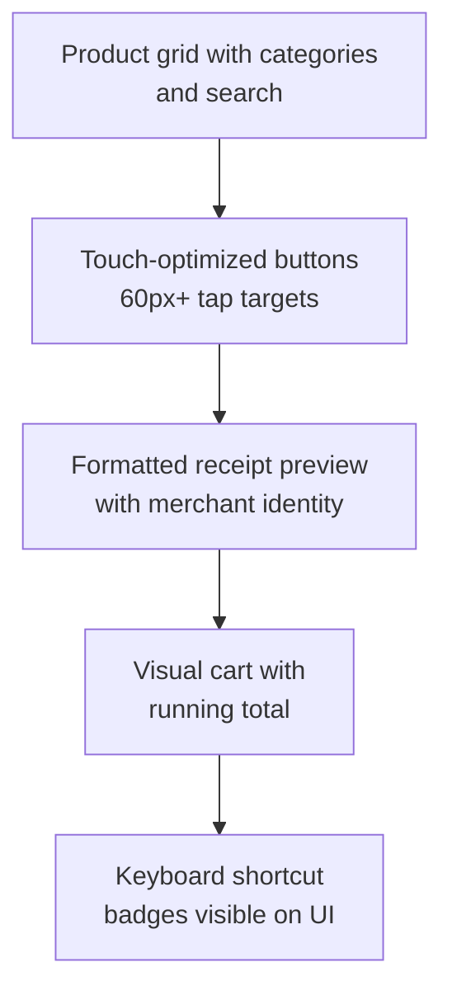

# ERA POS vs Real POS Systems — The Honest Gap

> [!CAUTION]
> **The backend is solid. The frontend is a developer prototype.** A store owner walking up to this would not recognize it as a POS. This document maps every gap between ERA POS today and what Indian/US retailers actually use, then proposes a practical plan to close those gaps.

---

## Side-by-side: What retailers see vs what ERA POS shows

### 🏪 Counter / Checkout (what the cashier uses)

| What real POS systems have | What ERA POS has today | Gap severity |
|---|---|---|
| **Large product image grid** — tap to add, organized by categories (Beverages, Snacks, Apparel) | Text-only product list filtered by search. No images, no categories, no grid of "quick-add" buttons. [Checkout.tsx L223-228](file:///c:/Users/ashish/Desktop/era-pos/apps/counter/src/renderer/Checkout.tsx#L223-L228) | 🔴 Critical |
| **Touch-optimized big buttons** — 60-80px tap targets, designed for touchscreen monitors | 15px font, standard browser inputs and buttons. Not touch-friendly. [theme.css L14](file:///c:/Users/ashish/Desktop/era-pos/packages/ui/theme.css#L14) | 🔴 Critical |
| **Split tender** — pay ₹500 cash + ₹300 UPI on the same sale | Cash OR UPI, never both. The fallback checkbox just records cash after a failed UPI. [Checkout.tsx L274](file:///c:/Users/ashish/Desktop/era-pos/apps/counter/src/renderer/Checkout.tsx#L274) | 🟡 Important |
| **Customer-facing display** — second screen showing items + total to the buyer | No dual-display support. Only the cashier sees the sale. | 🟡 Important |
| **Quick favorites / hot keys** — frequently sold items pinned to the main screen | No favorites. Only F1-F5 keyboard shortcuts exist. No pinned products. | 🟡 Important |
| **Item categories and departments** — "Clothing > Men > Shirts" hierarchy | Flat catalog with optional JSON attributes. No category tree, no department structure. | 🟡 Important |
| **Product images** — visual confirmation of what's being sold | Zero image support in catalog schema, API, or UI. | 🟡 Important |
| **Cashier PIN login per shift** — multiple cashiers use the same register | No cashier identity. Whoever opens the app has full access. | 🟡 Important |
| **Visual receipt preview** — formatted receipt shown before printing | `window.print()` opens browser print dialog. No formatted preview. [print.ts](file:///c:/Users/ashish/Desktop/era-pos/apps/counter/src/main/print.ts) | 🔴 Critical |
| **Cash drawer trigger** — receipt printer opens the cash drawer | No hardware integration beyond barcode scanner keyboard detection. | 🟡 Important |
| **Age/ID verification prompts** — for restricted items | No item restrictions or age-gate prompts. | 🟢 Later |
| **Weighing scale integration** — for grocery by weight | Zero scale support. Only fixed-quantity items. | 🟢 Later |
| **Item notes / custom modifiers** — "No sugar", "Gift wrap" | No line-item notes. No modifiers. | 🟢 Later |

### 📊 Owner Dashboard (what the merchant sees on web)

| What real POS systems have | What ERA POS has today | Gap severity |
|---|---|---|
| **Visual dashboard with charts** — revenue trends, hourly sales heatmap, top products, category breakdown | Three number cards (gross sales, returns, registers) + a plain text "synced/provisional" note. [Overview.tsx](file:///c:/Users/ashish/Desktop/era-pos/apps/web/src/merchant/Overview.tsx) — 33 lines total. | 🔴 Critical |
| **Real-time sales feed** — live ticker of transactions as they happen | "Load recent sales" button that fetches last 100 manually. [CashSales.tsx L16-18](file:///c:/Users/ashish/Desktop/era-pos/apps/web/src/merchant/CashSales.tsx#L16-L18) | 🟡 Important |
| **Top selling products** — ranked list with quantities and revenue | No aggregation queries. Raw sale list only. | 🔴 Critical |
| **Low stock alerts** — "Only 3 left of Blue T-Shirt M" | Inventory shows on-hand numbers but no alert threshold, no notification, no badge. | 🟡 Important |
| **Date range reports** — "Show me last week's sales" | Single-day daily close only. No range selector, no week/month view. | 🔴 Critical |
| **Proper charts** — bar, line, pie charts for sales trends | One `<meter>` element per register. No chart library. [DailyClose.tsx L62-63](file:///c:/Users/ashish/Desktop/era-pos/apps/web/src/merchant/DailyClose.tsx#L62-L63) | 🔴 Critical |
| **Employee performance** — sales per cashier, avg transaction value | No data grouped by cashier/operator. | 🟡 Important |
| **Customer database** — purchase history, contact, store credit | Zero customer data model. Every sale is anonymous. | 🟡 Important |
| **Notifications** — email/SMS/push for low stock, failed sync, shift not closed | No notification system at all. | 🟡 Important |

### 🧾 Receipts & Printing

| What real POS systems have | What ERA POS has today | Gap severity |
|---|---|---|
| **Formatted thermal receipt** — merchant name, GST#, logo, address, item table, payment breakdown, QR for returns, footer | Browser print dialog → plain HTML page. No receipt template. | 🔴 Critical |
| **Digital receipt** — email/SMS/WhatsApp the receipt | No email, no SMS, no WhatsApp. Print only. | 🟡 Important |
| **GST-compliant invoice** — HSN code, GSTIN, place of supply, tax breakup (CGST/SGST/IGST) | Zero tax. `taxMinor` exists in the schema but is always 0. No GST fields. | 🔴 Critical |
| **Barcode on receipt** — for easy returns scanning | No barcode/QR on printed receipts. | 🟡 Important |
| **Receipt customization** — owner configures header, footer, logo, return policy | No business settings UI. Hardcoded "ERA POS" branding. | 🟡 Important |

### 🎨 UI/UX Quality

| What real POS systems have | What ERA POS has today | Gap severity |
|---|---|---|
| **Polished design system** — consistent spacing, elevation, color hierarchy, icons | 41 lines of CSS variables. No icon library. No elevation/shadow system. Plain `
/
` for collapsibles everywhere. | 🔴 Critical |
| **Loading states** — skeletons, spinners, progress bars | A few `role="status"` text messages like "Loading catalog…" | 🟡 Important |
| **Animations & transitions** — smooth page transitions, cart add animations | Zero CSS transitions or animations. | 🟡 Important |
| **Professional iconography** — icons for each section, product categories, action buttons | Zero icons. Text-only buttons everywhere. | 🔴 Critical |
| **Proper empty states** — illustrations when "No sales yet" | Plain text: "No matching products." "No synced sales." | 🟡 Important |
| **Toast notifications** — success/error messages that auto-dismiss | `useState` messages inline in the page. No toast system. | 🟡 Important |
| **Keyboard shortcut hints** — visible shortcut badges on buttons | Shortcuts exist (F1-F10, Escape) but are invisible. Undiscoverable. | 🟡 Important |

---

## What the competitors actually look like

### India — What merchants use daily

**Busy Accounting + POS** / **Marg ERP** / **Gofrugal** / **Zoho POS**:
- Touch-optimized product grids with images and category tabs
- GST-compliant invoicing built-in (HSN codes, GSTIN, e-invoicing)
- Tally integration for the accountant
- WhatsApp receipt sharing
- Multiple payment methods on one bill
- Barcode label printing from the catalog
- Supplier purchase orders with auto-reorder
- Multi-language support (Hindi, regional languages)
- Scheme and offer management (Buy 2 Get 1, Diwali sale pricing)

**ERA POS has none of these.**

### USA — What merchants use daily

**Square POS** / **Clover** / **Shopify POS** / **Lightspeed**:
- Beautiful, iPad-friendly touch interfaces
- Item modifier groups ("Add extra shot +$0.50")
- Tip support on card terminals
- Gift cards and store credit
- Customer loyalty programs
- Real-time analytics with charts
- Employee time clock
- Appointment booking (for service businesses)
- eCommerce integration
- Hardware ecosystem (card reader, cash drawer, receipt printer, barcode scanner all integrated)

**ERA POS has none of these.**

---

## The plan: From prototype to commercial product

> [!IMPORTANT]
> **You don't need to build everything the competitors have.** You need to build enough that a store owner walks up and says "this looks like a real POS" and can run their daily workflow without friction. Focus on what makes the pilot store succeed.

### Phase 1 — Make the counter look and feel like a POS (2-3 weeks)

This is the highest-impact work. A cashier staring at this screen 8 hours a day needs it to feel professional.

**What to build:**

| Item | What it means concretely | Effort |
|------|--------------------------|--------|
| **Category-based product grid** | Add `category` field to catalog. Display products as large card tiles organized by category tabs. Tap to add. Keep search/scan as alternate input. | 3 days |
| **Touch-optimized layout** | Increase all tap targets to 48-60px minimum. Larger font sizes on counter (18-20px base). Bigger quantity +/- buttons. | 2 days |
| **Icon library** | Add Lucide icons (lightweight, MIT). Icons on nav tabs, action buttons, status indicators. | 1 day |
| **Receipt template** | Proper formatted receipt: merchant name, address, GSTIN, item table with columns, payment breakdown, QR code for returns, "Thank you" footer. Preview in-app before printing. | 3 days |
| **Visual cart redesign** | Card-based cart items with product name, price, quantity stepper (+ / -), line total. Running subtotal, tax line, discount, grand total at bottom. | 2 days |
| **Toast notification system** | Replace inline `useState` messages with auto-dismissing toast notifications at the bottom of the screen. | 0.5 day |
| **Shortcut hints** | Show "F1" badge on Sell tab, "F5" on search, "F9" on Complete, "F10" on Close shift. | 0.5 day |
| **Loading skeleton** | Replace "Loading…" text with skeleton rectangles that pulse. | 0.5 day |

### Phase 2 — Make the owner dashboard useful (1-2 weeks)

The owner needs to see their business health at a glance, not click "Load" buttons.

| Item | What it means | Effort |
|------|---------------|--------|
| **Dashboard with real charts** | Add a chart library (Recharts or Chart.js). Show: daily revenue trend (last 7 days), hourly sales heatmap, top 10 products by quantity, payment mix (cash vs UPI) pie chart. | 4 days |
| **Date range selector** | Replace single-date picker with a range picker. "This week", "This month", "Custom range" presets. | 1 day |
| **Top products / category breakdown** | New API endpoint that aggregates sales by SKU and category. Display as a ranked table. | 2 days |
| **Low stock alerts** | Add `alert_threshold` field per SKU. Show a badge count in the sidebar: "3 items below threshold". List on Overview. | 1.5 days |
| **Auto-load on section switch** | Remove all "Load recent sales" / "Load inventory" buttons. Fetch data automatically when the user opens a section. | 1 day |
| **Session persistence** | Store session in `localStorage`. Restore on page refresh. | 0.5 day |

### Phase 3 — Tax, receipts, and India compliance (1-2 weeks)

Without GST, you cannot sell to any registered Indian business.

| Item | What it means | Effort |
|------|---------------|--------|
| **GST tax engine** | Tax rate configuration per category (5%, 12%, 18%, 28%). HSN code on each SKU. Tax-inclusive pricing toggle. CGST/SGST split for intra-state, IGST for inter-state. | 5 days |
| **GST-compliant receipt fields** | GSTIN of merchant, place of supply, HSN codes, tax breakup per line, total tax summary. | 2 days |
| **Business settings screen** | Owner configures: business name, legal name, address, GSTIN, logo, receipt header, receipt footer, return policy text. | 2 days |
| **Thermal ESC/POS printing** | Generate ESC/POS binary commands for 58mm/80mm printers. Auto-detect paper width. Cash drawer kick command. | 3 days |

### Phase 4 — Cashier management and hardware (1-2 weeks)

| Item | What it means | Effort |
|------|---------------|--------|
| **Cashier PIN unlock** | PIN pad screen at shift start. Lock after 5 min idle. Each cashier has their own sales tracked. | 2 days |
| **Split payment** | Allow part-cash, part-UPI on one sale. Record both tender amounts on the receipt. | 2 days |
| **Digital receipts** | Email receipt after sale. Optional SMS via a provider API. | 2 days |
| **Customer-facing display** | Second window/screen showing: item being scanned, running total, "Thank you" after payment. | 2 days |
| **Cash drawer integration** | Send ESC/POS drawer kick command after receipt prints. | 0.5 day |

### Phase 5 — Scale features (after pilot)

| Item | Effort |
|------|--------|
| Product images in catalog | 2 days |
| Customer database + purchase history | 4 days |
| Item modifiers ("Gift wrap +₹20") | 3 days |
| Supplier purchase orders | 5 days |
| Multi-store stock transfers | 5-7 days |
| Cross-store returns | 3-5 days |
| Barcode label printing | 2 days |
| Tally export (India) | 3 days |
| US card terminal integration | 5-7 days |
| US state/local tax | 3-5 days |
| WhatsApp receipt (India) | 2 days |
| Loyalty points + store credit | 4 days |
| Employee time clock | 2 days |

---

## Effort summary

| Phase | Focus | Estimated time |
|-------|-------|---------------|
| **Phase 1** | Counter UX overhaul | 2–3 weeks |
| **Phase 2** | Owner dashboard | 1–2 weeks |
| **Phase 3** | Tax + compliance | 1–2 weeks |
| **Phase 4** | Cashier + hardware | 1–2 weeks |
| **Phase 5** | Scale features | Ongoing |

**Total to reach pilot-ready: ~6-9 weeks of focused engineering.**

---

## The good news

> [!TIP]
> **Your backend is ahead of most indie POS startups.** The transaction engine, dedup logic, offline sync, settlement matching, tenant isolation, billing lifecycle, support ticketing — all of that is production-quality code. The competitors you're comparing against took years to build those backend systems. What you need is **a frontend overhaul and business-specific features**, not a rewrite.

The concrete starting point: **Phase 1, item 1 — rebuild the counter checkout screen with a category-based product grid and touch-sized buttons.** That single change will make the app visually unrecognizable from what it is today, in the best way.

## Implementation sequence and acceptance checks

| Milestone | Build order | Acceptance check |
|---|---|---|
| Counter checkout | Extend catalog imports and cached snapshots, then update the Sell screen and share one receipt template between preview and print. | Import both CSV formats, reopen a cached catalog offline, scan and tap items, park and resume, pay, and look up the receipt by its printed ID. |
| Owner dashboard | Aggregate sales in branch-local time with role-scoped queries. Add range selection, charts, stock thresholds, automatic loading and session restoration. | Compare the charts with daily close across a date boundary. Switch branches and verify that each view uses its own sales and stock. |
| Tax and printing | Configure tax rules and merchant identity, snapshot line taxes at sale time, then add invoice rendering and printer transport. | Reconcile inclusive and exclusive prices, discounts and returns against reviewed examples. Print and scan a sample on each supported printer width. |
| Cashier and hardware | Bind shifts and sales to a cashier, add tender allocations and reconciliation, then connect the second display, digital receipts and drawer. | Restart during a split payment, replay the sale, and verify a single receipt, the correct cash balance and one drawer opening. |
| After pilot | Sequence scale features against pilot demand and select providers for terminal payments, messaging and regional tax. | Run a store workflow for each selected feature using the intended provider or device before rollout. |
